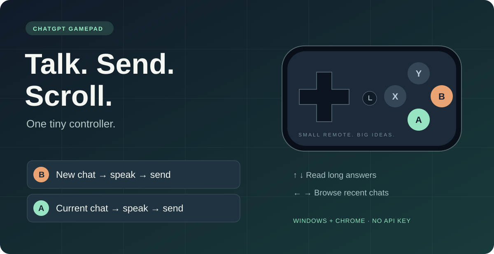

<p align="center"></p>
<p align="center"><a href="README.md">English</a> · <b>简体中文</b> · <a href="https://shiroppu69.github.io/chatgpt-gamepad/">交互介绍</a> · <a href="https://github.com/ShiroPpu69/chatgpt-gamepad/releases/latest">下载最新版</a></p>

# 给 ChatGPT 配一个小手柄。

**按 B，新建对话并开始听写；说完再按 B，直接发送。** A 在当前对话继续录音发送，方向键浏览长回复、切换最近对话。

使用已经登录的 ChatGPT 网页，**无需 API Key**。完成一次校准后可以登录 Windows 自动后台运行，不用每次打开控制器窗口。

已通过用户实际验证：**SHANWAN Q36XDV，X 档，Windows + Chrome**。其他 SDL 兼容手柄可能可以校准使用，但尚未验证。

## 六个控制，记住就能用

| 按键 | 操作 |
|---|---|
| **B** | 新建对话并开启听写 → 再按 B 停止录音、等待转写、自动发送 |
| **A** | 当前对话开启听写 → 再按 A 停止录音、等待转写、自动发送 |
| **↑ / ↓** | 平滑滚动当前对话，长按连续滚动 |
| **← / →** | 按最近列表的顺序切换普通对话 |

B 发送后，再按 B 会新建下一段对话；A 发送后，再按 A 仍留在原对话。用开启录音的同一按键结束。

这里使用的是 ChatGPT 的**听写（语音转文字）**，发送的是文本消息，不是实时语音通话，也不会让回复自动朗读。

## 为什么用手柄？

一边想一边说，或者靠着椅子读一段很长的回复，不用不断去找输入框和鼠标滚轮。**B 开始新的，A 接着当前的**，主要操作只需一个拇指。

- 听写按钮可用就启动，不等待整页资源加载完。
- 上下使用网页自身的滚动接口，不模拟鼠标或键盘，不移动指针；支持负坐标的反向正文布局。
- 左右只选最近里的普通对话，排除已识别的置顶和项目对话；录音中或有未发送文字时阻止切换。
- 配置一次后可以静默自动启动。项目没有额外账号或 API 订阅，ChatGPT 自身额度仍然适用。

## 五步开始

准备：Windows 10/11、Chrome 116+、Python 3.12+、有听写功能的 ChatGPT 账号、麦克风和手柄。普通使用不需要 Node.js。

1. 下载 [最新版本 ZIP](https://github.com/ShiroPpu69/chatgpt-gamepad/releases/latest)，解压到固定目录，或者克隆本仓库。
2. 在目录中打开 PowerShell，运行：

   ```powershell
   powershell -NoProfile -ExecutionPolicy Bypass -File .\setup.ps1
   ```

   自动安装 Python 依赖并生成本机独有的配对令牌。
3. 在 Chrome 打开 `chrome://extensions`，启用「开发者模式」，点击「加载已解压的扩展」，选择本项目的 `extension` 文件夹。
4. 双击「启动控制器.vbs」，连接手柄，点击「校准实体 B 键」，先松开再按一次 B。A 默认编号为 0，如果不符合实体按键就校准 A。多个手柄时先选择目标设备。
5. 打开并登录 ChatGPT，首次听写按 Chrome 提示允许麦克风。按 B，说一句话，再按 B 发送。

## 不用再打开控制器窗口

完成校准后，先结束录音并关闭控制器窗口，然后运行：

```powershell
powershell -NoProfile -ExecutionPolicy Bypass -File .\setup-background.ps1
powershell -NoProfile -ExecutionPolicy Bypass -File .\start-background.ps1
```

后台监听会立即启动，并在以后登录 Windows 时自动运行。扩展自动连接；点击扩展图标查看连接状态。请保留项目目录，后台需要其中的 Python 环境。

安装脚本也会尝试注册每分钟检查一次的 Windows 计划任务：后台退出后自动恢复，不会重复监听按键。若系统禁止注册，脚本会提示，登录启动仍保留。扩展显示「后台手柄监听：未连接」代表本地监听未连接，并不表示蓝牙手柄未配对；可以运行 `start-background.ps1` 立即恢复。

取消登录自动启动：运行 `setup-background.ps1 -Disable`。当前进程会继续到注销。需要重新校准时，先在任务管理器结束本项目的后台 `pythonw.exe`，再打开原控制器窗口。

## Q36 自动回连

手柄拨到 **X 档**，首次配对蓝牙名 `Xbox Wireless Controller`。日常短按 **HOME / 回连键**，蓝灯常亮表示连接成功；Pair 用于进入配对模式。Windows 的已保存蓝牙记录不代表手柄当前在线。

## 使用边界与排查

- 项目是非官方原型，需要手动加载扩展，不是 Chrome 商店或 OpenAI 官方产品。
- ChatGPT 网页布局会变化。更新后重新加载扩展并刷新页面；如果无法识别按钮，请提交版本、复现步骤和相关日志。
- 左右仅遍历当前加载的最近列表，到边界不循环，不遍历项目、置顶或全部历史归档。
- 只映射十字键、A 和 B；摇杆、X 和 Y 尚无功能。仅上下支持长按重复。
- A 和方向键优先操作 Chrome 最后聚焦窗口当前选中的 ChatGPT 标签页；没有时回退到记录的标签页。多标签页导致目标不明确时请关闭多余标签。
- 自动发送等待非空转写和可用按钮，不发送空消息，不盲目重复发送。失败时保留输入文字。
- 扩展或监听断开时网页录音可能仍在进行，**请在 ChatGPT 手动停止麦克风**。
- 日志为 `controller.log`；启动错误为 `startup-error.log`。提交问题前删除私人信息，不要上传配对文件。

## 隐私与实现

手柄 → Python / SDL → 带配对令牌的本机 WebSocket → Chrome 扩展 → ChatGPT 网页控件。

服务只监听 `127.0.0.1:19836`。扩展会检查控件和输入内容来协助听写、发送和保护草稿，不向本地程序复制对话正文、音频、Cookie 或剪贴板。项目没有遥测。语音和消息仍由你现有的 ChatGPT 账号处理。[安全与隐私](SECURITY.md)

## 开发与贡献

```powershell
npm ci --ignore-scripts
npm test
./.venv/Scripts/python.exe -m unittest discover -s tests -v
./.venv/Scripts/python.exe controller.py --diagnose
```

当前包含 **65 项 JavaScript 测试和 14 项 Python 测试**，覆盖听写确认与发送、最近列表过滤、长按防抖、普通与负坐标滚动。实际手柄兼容性仍需要实机验证。

欢迎报告其他手柄的测试结果、修复网页适配问题。[贡献指南](CONTRIBUTING.md) · [更新日志](CHANGELOG.md) · [提交问题](https://github.com/ShiroPpu69/chatgpt-gamepad/issues/new/choose)。如果这个小工具让你的手柄有了新用途，点个 ⭐ 能帮助更多人发现它。

独立实现，参考 AntiMicroX、stadia-macos-controller、ONE voice 的相关思路，以及 [ChatGPT Scroll Fix](https://github.com/soshroom/chatgpt-scroll-fix) 对反向布局的调查。本项目仅适配滚动坐标，不应用其 CSS 或原型代理。完整参考见英文首页。

[MIT 开源协议](LICENSE)。与 OpenAI、SHANWAN、Microsoft 无隶属关系，产品名称归对应权利人所有。
